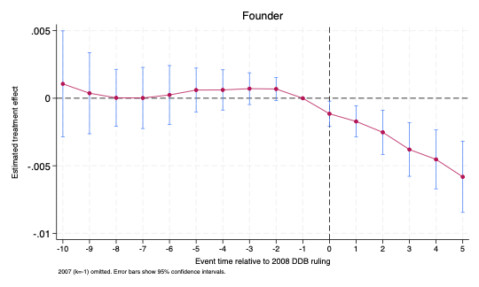
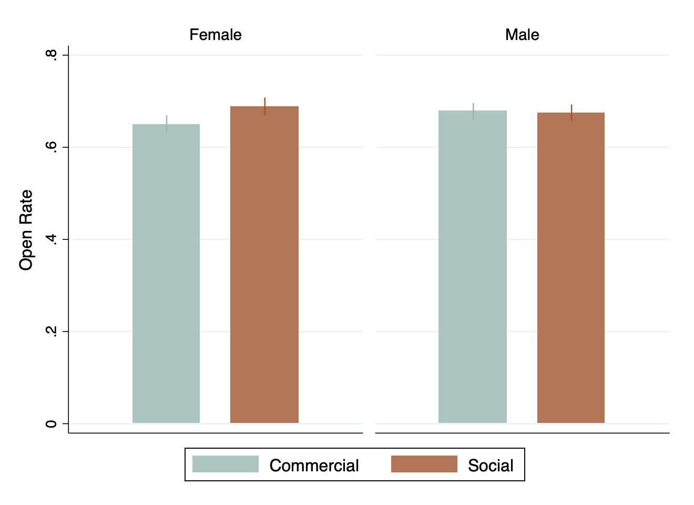
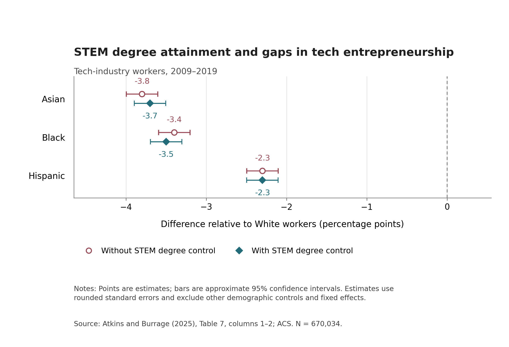
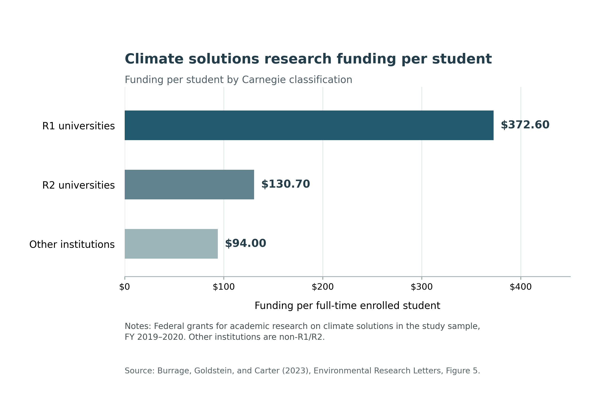

## Job Market Paper

### Employee Intellectual Property Rights and Innovation-Driven Entrepreneurship

with [Jillian Grennan](https://www.jilliangrennan.com/)

[Paper](/job-market-paper/burrage-grennan_job-market-paper.pdf)

Abstract

Who owns an idea before it becomes an invention and how do strengthened employer ownership rights shape entrepreneurship? We exploit a 2008 Federal Circuit decision that widened the gap in employer ownership rights over employee inventions across states with and without employee-invention protections. Linking employment histories, patents, and venture-financing data, we examine entrepreneurial transitions among inventors and patent-adjacent workers employed by established firms. Stronger employer rights significantly reduce entrepreneurial entry among inventors relative to comparable patent-adjacent workers. We then use patent text and Cooperative Patent Classification (CPC) codes to examine the technological direction of inventors who found ventures. We found that founders in states without employee-invention protections pursued technologies further from their prior inventions relative to founders in states with employee-invention protections, even when employee protections were considered. Our findings suggest that ownership rules for employee inventions shape both entrepreneurial entry and the direction of subsequent innovation.

Estimated effects on founder outcomes relative to the 2008 DDB ruling.

---

## Peer-Reviewed Papers

### Gender Diversity in Academic Entrepreneurship: Social Impact Motives and the NSF I-Corps Program

with [Nilanjana Dasgupta](https://www.umass.edu/psychological-brain-sciences/about/directory/nilanjana-dasgupta) and [Ina Ganguli](https://websites.umass.edu/iganguli/) 
*Research Policy*, 2025

[Journal Link](https://doi.org/10.1016/j.respol.2024.105169)

Abstract

This study examines gender differences in the social impact and commercial motives for academic entrepreneurship using the National Science Foundation’s Innovation Corps (NSF I-Corps) program. I-Corps provides experiential entrepreneurship training to faculty and graduate student researchers at local I-Corps university sites and through a nationwide program. Since the inception of I-Corps, only 20% of participants have been women. We first use survey data from one I-Corps university site to show that women had higher social entrepreneurial intentions compared to commercial entrepreneurial intentions, and their social entrepreneurial intentions were higher than men’s. We then extend and generalize this finding by analyzing 1267 publicly available project summaries from the National I-Corps Program from 2011 to 2019. We find that women PIs’ project proposals emphasized social impact significantly more than men, while projects for all PIs emphasized commercial impact to a similar degree. We next ran a field experiment to estimate the causal impact of social impact vs. commercial motives by experimentally manipulating the recruitment email messages inviting researchers to participate in the I-Corps training program. We find that women were more likely to show interest in a social impact version of a message compared to a commercial version, while men showed equal interest in both types of messages. Taken together, our results indicate that women are more interested in pursuing commercialization and entrepreneurship activities when they are tackling societal problems. They suggest that low-cost interventions that emphasize the social impact value of entrepreneurial opportunities may increase gender diversity in entrepreneurship activities.

<figure>

<figcaption>Gender difference in the effect of email framing on email opens.</figcaption>
</figure>

---

### Beyond the Pipeline (Problem): Examining Racial and Ethnic Representation in 21st Century High Technology Self-employment

with [Rachel Atkins](https://www.rachelmbatkins.com/home) 
*Journal of Economics & Management Strategy*, 2025

[Journal Link](https://doi.org/10.1111/jems.12629)

**Cited by the Brookings Institution:** [Tonantzin Carmona and Peter Rezk, “Centering Racial Equity and Inclusion in Pittsburgh’s Innovation Economy”](https://www.brookings.edu/articles/centering-racial-equity-and-inclusion-in-pittsburghs-innovation-economy/).

Abstract

Is the racial variation in the tech labor force and tech entrepreneurship associated with differences in STEM degree attainment? Using data from the American Community Survey, we examine whether racial disparities in tech employment and entrepreneurship reflect differences in STEM degree attainment within the labor force, a challenge known as the tech pipeline problem. We document that White workers are overrepresented in tech entrepreneurship, while Black, Hispanic, and Asian workers are underrepresented in tech entrepreneurship. Notably, Black workers are the only group underrepresented in tech employment relative to their share of the STEM-educated labor force. Our findings suggest that gaps in STEM degree attainment account for only a small portion of the racial disparity in the tech labor force. We also find important differences in the relationship between STEM degree attainment, tech employment, and tech entrepreneurship by race. We conclude the paper with a proposed research agenda for further study.

<figure>

<figcaption>Differences in tech entrepreneurship relative to White workers, with and without a STEM degree control.</figcaption>
</figure>

---

### Disciplinary and Institutional Diversity of Federally Funded Academic Research on Climate Solutions in the United States

with [Anna Goldstein](https://www.primecoalition.org/people-library/anna-goldstein) and [Tim Carter](https://secondnature.org/team/timothy-carter/) 
*Environmental Research Letters*, 2023

[Journal Link](https://doi.org/10.1088/1748-9326/ad0166)

Abstract

To meet the demands of technological change required for climate change mitigation, academic research must cover a broad range of climate solutions. Diverse participation in this research is important because research shows that a variety of backgrounds and problem-solving approaches are important to solving complex problems such as climate change. In our study, we examine the disciplinary and institutional diversity of federal funding for academic research on climate solutions (ARCS) in the United States. We identify $1.42 billion in federal funding for ARCS in fiscal years 2019 and 2020. Our findings reveal that 85% of federal ARCS grants are awarded to Principal Investigators in engineering and the natural sciences. Additionally, institutions classified as having high research activity (R1s) receive over 60% of the ARCS funding per student. Tribal institutions, Historically Black Colleges and Universities, and Hispanic Serving Institutions collectively receive only $109.20 in ARCS funding per student, compared to $334.30 per student for other institution types. These disparities in federally funded ARCS grants are, in part, a consequence of the absence of policies that promote interdisciplinary collaboration and broader participation in academic research. We discuss the policy implications that have contributed to the identified inequities in ARCS funding and current policies that could enhance the distribution of ARCS in the future. We propose strategies for federally funded ARCS to support an equitable energy transition that addresses the needs of contemporary society and beyond.

<figure>

<figcaption>Climate solutions research funding per full-time enrolled student, by institution type.</figcaption>
</figure>

---

## Working Papers

### Career Pathways to Capital: Investor Affiliations and Inequality among Black Founders

with [Alicia Myles Sheares](https://www.aliciasheares.com/home)

Abstract

This paper examines how entrepreneurs draw on their experiences and professional connections to acquire resources for their ventures. Focusing on Black founders, we investigate how career experiences and networks shape access to resources and opportunities for venture development.

---

### From Students to Inventors: Talent and the Pathway to Invention

with [Ina Ganguli](https://websites.umass.edu/iganguli/)

Abstract

This paper examines how early inventive talent develops and how institutional outreach shapes participation in invention opportunities. Using data on applicants to the Lemelson-MIT Student Prize, we follow student inventors into patenting and study how university outreach affects the composition of the applicant pool.

---

### From Complementarity to Constraint: Firm Navigation of Overlapping Innovation Incentives

Abstract

This paper examines how firms make strategic choices about where to direct resources and capabilities in support of innovation. I explore how changes in the opportunities available to firms shape their allocation of organizational resources and their engagement in different innovation-related activities. The study considers how firms navigate competing demands as they pursue and develop opportunities over time.

---

## Other Publications

### Inclusive Pathways to Invention: Racial and Ethnic Diversity Among Collegiate Student Inventors in a National Prize Competition

with [Janell Ciemiecki](https://upop.mit.edu/profiles/janell-ciemiecki/), [Stephanie Couch](https://lemelson.mit.edu/forging-pathway-invention-education/leadership-staff/stephanie-couch), and [Ina Ganguli](https://websites.umass.edu/iganguli/) 
*Technology & Innovation*, 2022

[Journal Link](https://doi.org/10.21300/22.3.2022.8)

Abstract

We present novel evidence from over 2,000 student inventors from colleges and universities across the United States who applied to a prestigious national prize. These unique data provide us with self-reported information about gender, race, and ethnicity for students earlier on the “pathway to invention” — young people who have already shown evidence of their inventiveness and are among those likely to be future patent holders. First, we show that 14% of prize applicants are from under-represented minority (URM) groups, which is a smaller gap than estimates of the racial/ethnic gap in patenting. We find striking differences in the focus of the inventions being created by URM inventors, particularly at the intersection of gender and race: URM men are much more likely than all other groups to work on consumer-oriented inventions and less likely to work on health care inventions. URM women are similar to non-URM students in being most likely to work on health care inventions. Differences by field of study show that URM men are more likely than other groups to come from business, and URM women are more likely to come from biological sciences. Finally, we show that slightly more URM applicants come from public research universities. A fruitful area for future research is examining the ways different types of universities support the development of URM students as inventors and contribute to URM students’ continuation on the pathway to invention.

---

### The Future of Academic Research on Climate Solutions

with [Tim Carter](https://secondnature.org/team/timothy-carter/) and [Anna Goldstein](https://www.primecoalition.org/people-library/anna-goldstein) 
*Second Nature*, 2022

[Report](https://secondnature.org/wp-content/uploads/Sloan-Foundation_Future-of-Academic-Research-Report.pdf)

Abstract

This report examines how federal funding for academic research on climate solutions is distributed across disciplines and institutions and how research can better contribute to equitable climate solutions. Drawing on data from 1,829 federal grants awarded in fiscal years 2019 and 2020 and interviews with key stakeholders, we find that funding is concentrated in natural sciences, engineering, and institutions with very high research activity. We recommend expanding participation across disciplines and institution types, strengthening partnerships with affected communities and industry, and improving coordination of federal research funding.

